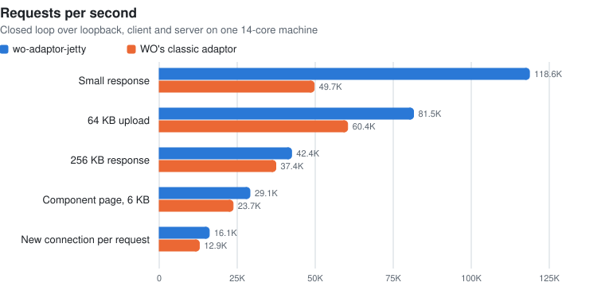
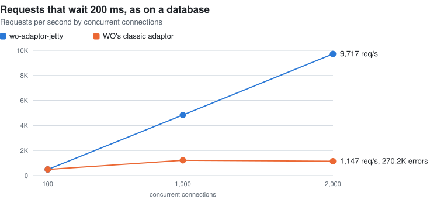

# 🏋️ wo-adaptor-jetty-bench

How many requests can a WebObjects application serve through [wo-adaptor-jetty](https://github.com/undur/wo-adaptor-jetty)?
This project answers with a plain WebObjects 5.4.3 application, a load generator, and a script that runs the same
scenarios against wo-adaptor-jetty and against WO's classic adaptor.

## Results

wo-adaptor-jetty 0.12.3 on a 14-core MacBook, JDK 25, 2 GB heap, 2026-11-05. Client and server on the same machine.

<p align="center"></p>

<p align="center"></p>

**Requests that wait are where the adaptors differ most.** A request waiting on a database or a remote service holds
a thread while it waits. wo-adaptor-jetty runs every request on a virtual thread, so 2,000 requests waiting 200 ms at
once are served at 2,000 / 0.2 s ≈ 10,000 per second, and p99 stays within 25 ms of the wait. The classic adaptor
serves at most 256 at a time and tops out at 256 / 0.2 s ≈ 1,280 per second. It resets the connections it has no
room for: at 2,000 connections, 270,000 connection attempts failed in 8 seconds, and 1,744 of the connections never got
an answer.

**Raw throughput: about 120,000 requests per second** with keep-alive, 2.4 times the classic adaptor's. The server
used about 6 cores and the load generator most of the rest, with no thread waiting on a lock, so that is the ceiling
of one machine running both, not of the adaptor.

**No errors.** Not one failed request in any wo-adaptor-jetty scenario.

| Scenario | wo-adaptor-jetty | | Classic adaptor | |
|:--|--:|--:|--:|--:|
| | **req/s** | **p99 ms** | **req/s** | **p99 ms** |
| Small response, 64 keep-alive connections | **118,643** | 1.9 | 49,664 | 14.2 |
| A new connection per request, 16 at a time | **16,056** | 0.6 | 12,859 ¹ | 0.7 |
| Component page, 6 KB, 64 connections | **29,078** | 8.3 | 23,670 | 7.9 |
| 256 KB response, 16 connections | **42,413** (13.8 GB/s) | 0.8 | 37,369 (12.2 GB/s) | 0.9 |
| 64 KB upload, 16 connections | **81,510** | 0.8 | 60,377 | 0.7 |
| 200 ms wait, 100 connections | 487 | 212 | 489 | 209 |
| 200 ms wait, 1,000 connections | **4,837** | 223 | 1,220 ² | 293 |
| 200 ms wait, 2,000 connections | **9,717** | 222 | 1,147 ² | 359 |

¹ 4,016 connection attempts failed because the client ran out of local ports, so this is partly the client's limit.<br>
² Plus 265,509 and 270,223 reset connection attempts. 744 and 1,744 connections never got a response.

The full output, including the configurations below, is in [results/2026-11-05-211101.txt](results/2026-11-05-211101.txt).

### WO's request lock

With concurrent request handling off, which is WO's default, WO serializes its component and direct action requests.
100 connections to a direct action that waits 200 ms got **2 requests per second**, against 487 with it on, and 87 of
the connections got no response in 8 seconds. Fast pages hardly notice: the component page ran at 25,134 per second
with the lock against 29,078 without, since no request holds it for long. The setting matters as soon as requests wait.

### Limiting concurrency

With `JettyMaxConcurrentRequests=50`, 1,000 connections to requests waiting 200 ms were served at exactly 50 / 0.2 s =
244 per second, the rest queued (p50 4.09 s), and none failed. Small requests ran at 117,962 per second, unaffected.

### Keep-alive and the classic adaptor

A `WOResponse` created with `new WOResponse()` says HTTP/1.0, and the classic adaptor closes the connection after
sending it. Responses generated from components answer in the request's version and keep the connection open.
wo-adaptor-jetty keeps connections open either way. The bench gives its hand-built responses the request's version
so that the comparison measures the adaptors, not connection setup. Without that, the classic adaptor served about
11,000 small requests per second instead of 49,664.

### Unexplained

In one of six full runs, the component page scenario had two connections that got no response for the whole 8 seconds,
and one request that took 6.4 s. It did not recur in the runs after it or in ten targeted runs, and in the runs with GC
logging no pause exceeded 24 ms.

### Caveats

Client and server share one machine's cores, over loopback, with no Apache or modulo in front. The scenarios are
synthetic. Read the numbers as the adaptor's ceiling and as a comparison between configurations, not as what a
production application will see.

## Running the benchmarks

### What you need

- JDK 25 and Maven. The WebObjects jars come from the WOCommunity repository, which `pom.xml` already names.
- `curl`, and Python 3 for the charts.
- About 7 minutes, plus 2 to 3 for each adaptor you add, and a machine left alone while it runs. Every scenario uses all the cores it can get, so other work
  skews the numbers.
- Tested on macOS. The script sticks to POSIX shell, `netstat`, `pkill` and `getconf`, so Linux should work.

### Run it

```
mvn package
./bench.sh
python3 docs/charts.py results/<timestamp>.txt
```

`bench.sh` launches the application afresh for each configuration, on port 7100, and writes everything it prints to
`results/<timestamp>.txt`:

1. wo-adaptor-jetty with concurrent request handling
2. wo-adaptor-jetty without it, as WO defaults
3. WO's classic adaptor (`-WOAdaptor WODefaultAdaptor`) with concurrent request handling
4. wo-adaptor-jetty with `JettyMaxConcurrentRequests=50`

Configurations 1 and 3, and any adaptor you add, run the full set of nine scenarios. 2 and 4 run only the scenarios
their settings affect.

`charts.py` draws one series for each adaptor that ran the full set, and writes `results/<timestamp>-throughput.svg` and
`results/<timestamp>-waiting.svg`. Give it a directory as a second argument to write elsewhere: `docs` redraws this
README's charts.

| Option | |
|:--|:--|
| `-d seconds` | How long each scenario measures, after a 2 second warmup. Default 8. `-d 2` gives a rough picture in a few minutes. |
| `-a class` | Also bench this adaptor. Repeatable. |
| `-cp classpath` | Jars the `-a` adaptors need, separated by `:`. |
| `-o` | Only compare adaptors: skip configurations 2 and 4. |

### Benchmarking another adaptor

Any `WOAdaptor` can run the same scenarios, as long as it listens on the port WO gives it with `-WOPort`. Pass the class
name you would give `-WOAdaptor`, and the jars it needs:

```
mvn package
./bench.sh -o -a com.example.MyAdaptor -cp ../my-adaptor/target/my-adaptor.jar:../lib/netty-all.jar
python3 docs/charts.py results/<timestamp>.txt
```

The adaptor then runs as an extra configuration after the others, with the jars added to its classpath only, so
wo-adaptor-jetty and the classic adaptor are measured as before, on the same machine and in the same run. Compare
numbers within one run: results from different machines don't compare.

If the adaptor is in a Maven repository, a dependency in `pom.xml` does the same as `-cp`. The built-in configurations
name their adaptor with `-WOAdaptor`, so an adaptor that selects itself when it is on the classpath doesn't take their
place.

The load generator reads bodies delimited by `Content-Length`, by chunked encoding, or by the connection closing, and
reconnects whenever the server closes a connection, so an adaptor that streams its responses or doesn't keep
connections alive is measured as it is. Connections it opens show up as `connects`.

### Reading the output

Each scenario prints one line:

```
  hello keep-alive c=64   requests=949181 rps=118643 p50=0.45 p90=0.91 p99=1.89 p999=7.56 max=47.58 MB/s=17 connects=0 resent=0 non2xx=0 errors=0 idleConnections=0
```

| Field | Meaning |
|:--|:--|
| `requests`, `rps` | Responses completed while measuring, and per second |
| `p50` … `max` | Latency in milliseconds, from writing the request to reading the end of the response |
| `MB/s` | Response bytes read per second, headers included |
| `connects` | Connections opened while measuring. 0 means every connection stayed open throughout |
| `resent` | Requests resent because the server had closed a reused connection |
| `non2xx` | Responses with a status outside 200–299 |
| `errors` | Failed connection attempts and requests, with the first one's exception in `firstError` |
| `idleConnections` | Connections that completed no request while measuring: the server never answered them |

### If something goes wrong

- **"The application did not start"**: the application's output is in `target/app-<configuration>.log`. For an added
  adaptor, look there for a `ClassNotFoundException`, and check the class name and `-cp`.
- **"Something is already answering on port 7100"**: an earlier run is still going, or something else has the port.
  `pkill -f wo-adaptor-jetty-bench` stops a left-over application.
- **`BindException: Can't assign requested address`** in the new-connection scenario: the client ran out of local
  ports, since every closed connection holds one for a while. The script waits for them to free up between scenarios,
  but a fast server can use them up within one. The count is the client's limit, not the server's.
- **`Too many open files`** at 2,000 connections: raise the limit with `ulimit -n 10000` before running.
- Each configuration also writes a GC log, `target/gc-<pid>.log`, for telling a slow request from a collector pause.

## The application

Endpoints under `http://127.0.0.1:7100/Apps/WebObjects/Bench.woa/`:

| Path | What it does |
|:--|:--|
| `b/hello` | A 5 byte text response |
| `b/sleep?ms=200` | Waits, as a request waiting on a database or a remote service does, then answers |
| `b/bytes?kb=256` | A response of that size |
| `b/upload` | A POST, answered with the length of its body |
| `wa/default` | A direct action rendering a component: a 100 row `WORepetition`, about 6 KB of HTML, no session |
| `wa/sleep?ms=200` | The wait, as a direct action |

The `b/` endpoints are a `WORequestHandler` of their own, so no context, page or session is created and what is
measured is the adaptor plus WO's dispatch. A custom request handler like this one is never serialized by WO's request
lock, which belongs to its component and direct action handlers. That is why the lock is tested with `wa/sleep`.

`-DBenchConcurrent=false` turns concurrent request handling off; the application turns it on otherwise.

## Hammer

[`Hammer.java`](Hammer.java) is the load generator: closed-loop HTTP/1.1, one platform thread per connection, a fixed
duration after a warmup, and latency percentiles from every request. `ab` is single-threaded and ran out of CPU at
about 97,000 requests per second, below what the adaptor serves.

```
java Hammer.java [-c connections] [-d seconds] [-w warmup seconds] [--close] [--post kilobytes] url
```

A reused connection that the server closed before a response began is reconnected and the request resent, as browsers
do, and counted as `resent`, not as an error. Response bodies may be delimited by `Content-Length`, chunked encoding or
the connection closing.
